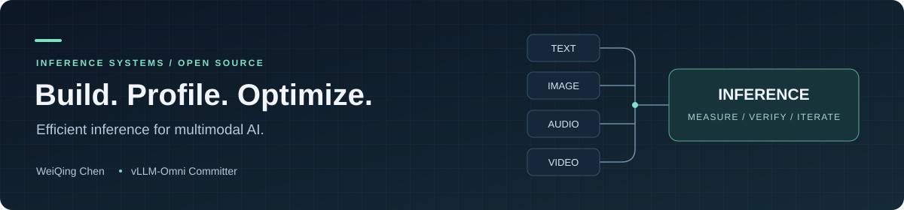

  

<h1 align="center">WeiQing Chen</h1>

  <strong>vLLM-Omni Committer · LLM &amp; Multimodal Inference · Open Source</strong>

  <a href="https://github.com/david6666666">GitHub</a> ·
  <a href="https://www.linkedin.com/in/weiqing-chen-7b617123b/">LinkedIn</a> ·
  <a href="mailto:530634352@qq.com">Email</a>

I work on **efficient inference for text, image, audio, and video models** — from model integration and distributed serving to profiling, kernel optimization, and reproducible benchmarks.

- **Open source:** committer at [vLLM-Omni](https://github.com/vllm-project/vllm-omni) and contributor to [vLLM](https://github.com/vllm-project/vllm).
- **Current focus:** diffusion inference, GPU/NPU performance, and inference optimization with coding agents.
- **Engineering approach:** profile the bottleneck, measure the improvement, and verify output quality.

### Selected contributions

| Area | Work | Merged PR |
| :--- | :--- | :--- |
| Diffusion performance | Qwen-Image-2.1-Turbo BF16 inference optimization on NVIDIA B300 | [vLLM-Omni #8739](https://github.com/vllm-project/vllm-omni/pull/8739) |
| Model integration | Direct FastH3 8-Step V2 checkpoint loading | [vLLM-Omni #7610](https://github.com/vllm-project/vllm-omni/pull/7610) |
| Distributed inference | Asynchronous expert rearrangement for expert parallel load balancing | [vLLM #22179](https://github.com/vllm-project/vllm/pull/22179) |
| Multimodal decoding | EAGLE / EAGLE3 support for Qwen2.5-VL | [vLLM #22872](https://github.com/vllm-project/vllm/pull/22872) |

### Projects & tools

| Project | What you'll find |
| :--- | :--- |
| [**vLLM-Omni**](https://github.com/vllm-project/vllm-omni) | Efficient inference and serving for models spanning text, image, audio, and video. |
| [**InferRSI**](https://github.com/InferMatrixLab/InferRSI) | A CLI workbench for inference optimization with coding agents, controlled comparisons, quality checks, and reusable tuning knowledge. |
| [**vllm-omni-skills**](https://github.com/david6666666/vllm-omni-skills) | AI assistant skills for model integration, serving, distributed inference, performance tuning, and code review. |

**A measured example:** an [InferRSI Qwen-Image-2.1-Turbo campaign](https://github.com/InferMatrixLab/InferRSI/blob/main/docs/qwen-image-2.1-turbo-b300.md) recorded **30.60% lower HTTP end-to-end latency** (384.16 → 266.60 ms), with **44/44 pixel-identical outputs**. Scope: 4× NVIDIA B300, BF16, 1280×704, native 8 steps, warm repeated prompts; results are specific to that workload.

### Stack & interests

**Python · PyTorch · CUDA · Ascend NPU · vLLM · Ray · Kubernetes**

Multimodal model serving · Diffusion acceleration · Distributed inference · Benchmarking & profiling · Agent-assisted optimization

---

Interested in multimodal inference or a reproducible performance problem? [Start a conversation](https://github.com/david6666666/david6666666/issues) or [send an email](mailto:530634352@qq.com).
